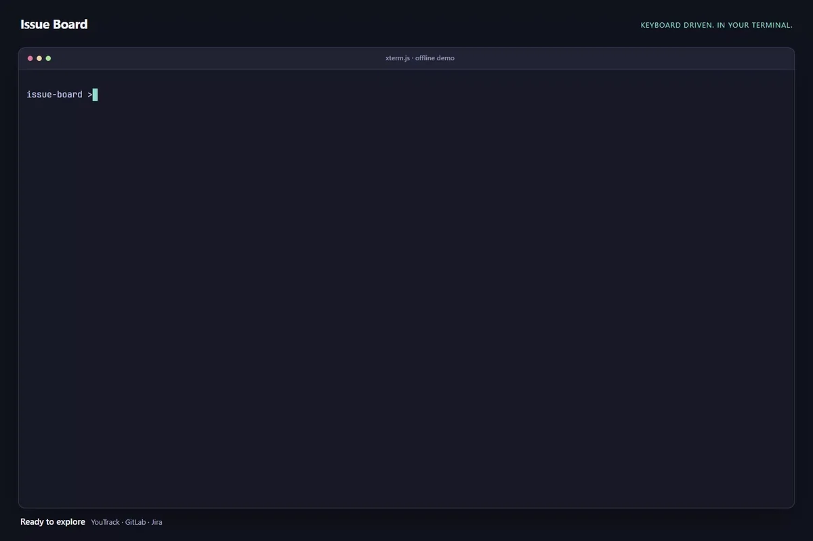
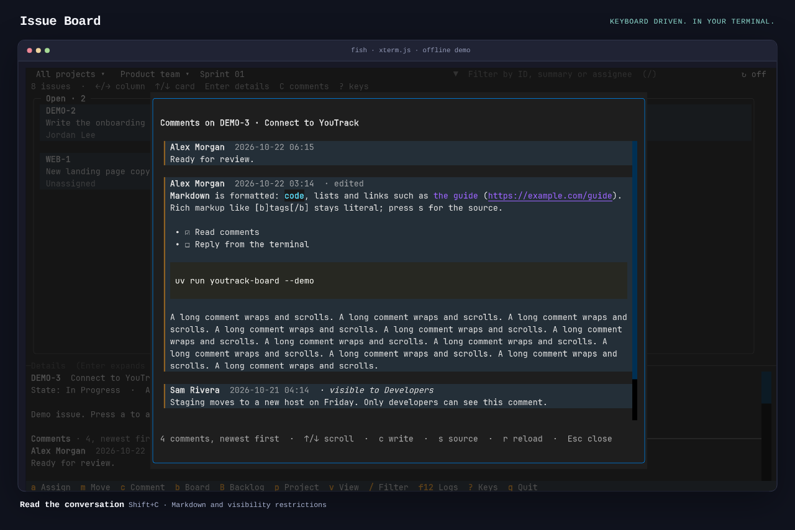
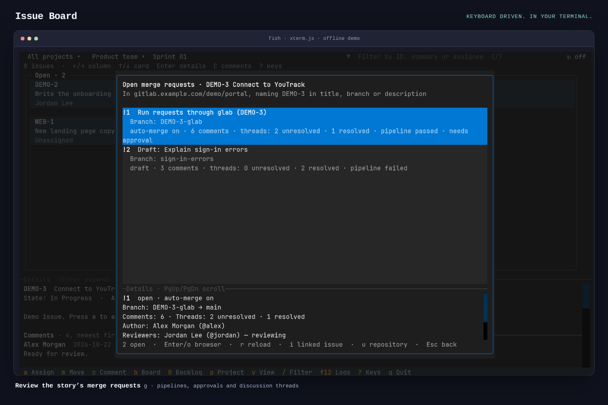
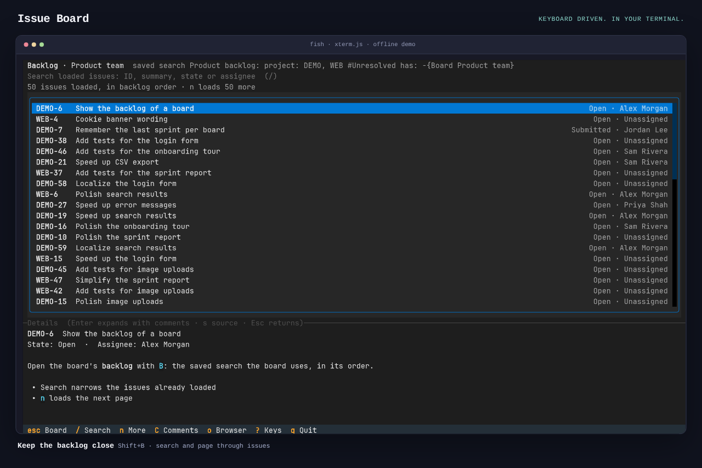

# Issue Board

[](docs/media/walkthrough-fast.mp4)

[**▶ Watch or download the MP4 (39 seconds)**](docs/media/walkthrough-fast.mp4) — move a story between columns, open its details, read and post comments, inspect GitLab merge requests and browse the backlog. Keyboard presses and clicks are highlighted. Recorded in xterm.js with fish, using the offline demo.

A keyboard-driven terminal issue board for YouTrack, GitLab and Jira Cloud. Run `issueboard` in your project folder to open its board.

<details>
<summary>More screenshots: comments, merge requests and backlog</summary>

Read formatted comments and reply without leaving the board.



See the story’s merge requests, pipelines, approvals and discussion status.



Search and page through the board’s backlog.



</details>

To recreate these captures, see the [saved terminal and recording workflow](docs/captures.md).

## Installation

Issue Board is public and available for macOS and Linux. No GitHub account or token is needed to download or install it.

### macOS: Homebrew

With [Homebrew](https://brew.sh) installed:

```sh
brew install danickfort/issueboard/issueboard
issueboard
```

Or run `brew tap danickfort/issueboard`, then `brew install issueboard`. Homebrew installs Python and the app dependencies in an isolated environment; no uv or source checkout is needed.

```sh
brew update
brew upgrade danickfort/issueboard/issueboard
brew uninstall issueboard
```

### Linux: download and run

Download the Linux x86_64 `.tar.gz` from [the latest release](https://github.com/danickfort/issue-board/releases/latest), then unpack and run it:

```sh
tar -xzf issueboard-0.3.3-linux-x86_64.tar.gz
./issueboard-0.3.3-linux-x86_64/issueboard
```

Python and dependencies are included. Requires glibc 2.35+ (for example Ubuntu 22.04+). Keep the extracted folder together.

### Run a board

```sh
issueboard                    # this folder's board; asks the first time
issueboard --setup            # choose this folder's tracker and board again
issueboard --demo youtrack    # or: issueboard --demo gitlab, issueboard --demo jira
issueboard youtrack --setup --open # replace the saved YouTrack connection
issueboard youtrack --auth-status
issueboard jira --setup            # sign in to a Jira Cloud site
```

GitLab boards require [glab](https://gitlab.com/gitlab-org/cli) and its own sign-in; on macOS use `brew install glab`, or on Linux install it with your distribution's package manager. YouTrack and Jira use the OS credential store; on Linux, a working Secret Service or KWallet session is needed to save tokens.

Uninstalling preserves your preferences and credentials. Run `issueboard youtrack --logout` and `issueboard jira --logout` before uninstalling to remove the apps' saved tokens. Existing MCP credentials are never changed. [Homebrew maintenance](docs/homebrew.md) and [release instructions](docs/releases.md).

## One board per project folder

The first time `issueboard` starts in a folder, it asks whether the folder's issues are in YouTrack, GitLab or Jira, then sets that up and remembers the board:

- **The folder** is the root of the Git checkout you are in, so all its subfolders share one choice, and each Git worktree has its own. Outside Git, it is the current folder.
- **The suggestion** comes from local clues only, each listed with the question: a saved link between this checkout's GitLab repository and a YouTrack project, previously opened GitLab boards for this project, or a branch name with an issue key such as `WEB-12` whose project another folder already opens a Jira board of. A GitLab remote alone suggests nothing: YouTrack and Jira projects often keep their code on GitLab. Nor does an issue key alone: YouTrack and Jira write them the same way. When the clues disagree, or there are none, nothing is preselected. Either way you confirm the choice, with Enter for a suggestion or a number.
- **Searchable choices.** Project and board lists filter as you type, using fuzzy matching (for example, `prdtm` finds “Product team”). Use ↑/↓ to highlight a match, Enter to select it, and Esc to cancel without saving. Clear the search to see the full list again.
- **YouTrack** signs in with `issueboard youtrack` ([credentials](#connect-to-youtrack)), then asks for a project (or All projects) and a board.
- **Jira** signs in with `issueboard jira` ([credentials](docs/jira-board.md#connect-to-jira-cloud)) and uses that site (run `issueboard jira --setup` first for another one), then asks for one of your recent projects, a typed project key or All projects, and a board.
- **GitLab** offers the checkout's GitLab remotes, or a project, group or board URL you type, then checks that glab is signed in to that host. If it is not, it offers to run `glab auth login --hostname <host>`, which keeps the token in glab. Then it asks for the board.
- **Nothing is saved** until setup succeeds. Ctrl+C, Ctrl+D, a declined sign-in or a failed check leaves the folder's previous choice, if any, as it was.

Later starts in that folder open the saved board directly. `issueboard --setup` asks again, with the current tracker preselected. Choices are kept in `$XDG_CONFIG_HOME/issueboard/directories.json` (or `~/.config/issueboard/directories.json`), keyed by folder path. Nothing is written to the project. They hold board IDs and URLs, never tokens. If that file is damaged, `issueboard` stops and names it rather than overwriting it. Without an interactive terminal, `issueboard` never prompts: in a folder without a choice, or with `--setup`, it exits and names the `issueboard youtrack`, `issueboard gitlab` and `issueboard jira` subcommands as alternatives. A Jira folder only ever opens with credentials for its own site.

## Try the demo

After installing, run:

```sh
issueboard --demo youtrack
issueboard --demo gitlab
issueboard --demo jira
```

The tracker subcommands also accept `--demo`. The YouTrack demo is described here, the GitLab demo in [GitLab](docs/gitlab-board.md). The Jira demo has a scrum board with several statuses per column and a 60-issue backlog, a kanban board with an empty column and a sub-filter, a scrum board without an active sprint, a formatted description (WEB-1, `Enter`), comments with a role restriction (WEB-3), and a *Done* transition that asks for the resolution.

No YouTrack account or credentials are needed. To run from a source checkout instead, see [Development](#development).

The demo includes multiple projects and boards. *Services desk* demonstrates project swimlanes, grouped status columns, and a board with sprints disabled. WEB's State follows a workflow, so its cards offer workflow transitions; *start* is refused for unassigned cards, as a workflow condition would. *Product team* spans DEMO and WEB, and the demo starts as if you had opened *Product team* five minutes ago and *Support kanban* yesterday. *Connect to YouTrack* (DEMO-3) has a comment thread, including one comment restricted to a group: `Enter` shows it under the details, `C` on its own. Press `g` on *Connect to YouTrack* (DEMO-3) for the GitLab merge requests naming it; DEMO's repository is already chosen. `G` lists every open merge request of that repository, and `i` on one opens the story it names. On a WEB story, `g` asks for a repository first: enter `https://gitlab.example.com/demo/api`. The demo's GitLab is offline and needs no glab. Press `B` for a board's backlog: *Product team*'s has 123 issues to page through, *Support kanban*'s a few, *Services desk*'s is empty and *Website launch* has none. Demo changes, visits and view settings stay in memory and disappear on exit. The demo never contacts YouTrack, never looks for credentials, and never reads or writes your saved state.

## Connect to YouTrack

After installing, start the app:

```sh
issueboard youtrack
```

The app looks for credentials in the places below. If none work, it guides you through the instance URL, token creation, and verification in the terminal. It asks for your instance's base URL (including any context path, for example `https://example.org/youtrack`) and a permanent token, with typing hidden. It checks them with a read-only sign-in (`GET /api/users/me`) and saves them. Setup never changes anything in YouTrack.

Create the token in **Profile → Account Security → Tokens** with the **YouTrack** scope. A token acts with your account's permissions: it needs access to the boards and permission to update the issues you want to change. No administrator permissions are needed.

### Where credentials come from

The first source that has credentials is used. A URL and its token always come from the same source, and a token is only ever sent to the URL it came with.

1. **Environment**: `YOUTRACK_URL` and `YOUTRACK_TOKEN`, both set. They are used for that session and never saved. If only one is set, the app stops and names the missing one rather than combining it with another source. If YouTrack rejects the token, the app stops; fix or unset the variables.
2. **Saved by this app**: the instance URL in your local configuration, and the token in the OS credential store, keyed by that URL. On macOS this is your login keychain.
3. **A YouTrack MCP server you already set up for Codex or Claude Code**: an entry in `~/.codex/config.toml` (`[mcp_servers.<name>.env]`) or `~/.claude.json` (`mcpServers.<name>.env`) that sets both `YOUTRACK_URL` and `YOUTRACK_TOKEN`. The entry is read in place on each start. It is not copied, and those files are never changed. The same URL and token in both files count as one. If there are several different entries, setup asks which one to use and saves your choice as in step 2.
4. Otherwise, setup runs.

When the board opens, a notification shows the account and the source, for example `track.example.com as jdoe · token from Codex MCP server "YouTrack" (~/.codex/config.toml)`.

The app does not read project-level MCP files, `.env` files, or other tools' credentials. It never runs MCP commands and never expands `$VAR` references (such entries are skipped). It ignores remote MCP servers that use OAuth: their logins are not YouTrack tokens.

### Change or remove credentials

- `issueboard youtrack --setup --open` opens your instance’s Account Security page after you enter its URL, then asks for a hidden token. Setup always prints the link as well, so it works without a browser. The browser is opened only once even if verification needs a retry. This guides permanent-token creation; it is not OAuth login.
- `issueboard youtrack --auth-status` checks the configured account and reports the instance and credential source without opening the board or asking for missing credentials. Offline results explicitly say the connection was not verified.
- `issueboard youtrack --setup` runs setup again: choose a found entry or type a URL and token. It checks and saves them, then opens the board. Use it to switch instances or replace a token. When the URL changes, the token saved for the old URL is removed.
- `issueboard youtrack --logout` removes the saved token from the credential store and deletes the config file, then exits. It lists any environment variables and MCP entries that it left alone and that would still be used on the next start.
- If YouTrack rejects a saved or discovered token (HTTP 401 or 403), the app says so and runs setup, with the URL filled in. A rejected entry is not offered again. Setup stops after three failed attempts and saves nothing; Ctrl+C or Ctrl+D cancels it.
- If YouTrack cannot be reached, the app does not ask for a new token. The board opens with the connection error, and `r` retries.
- Without an interactive terminal, the app does not prompt. It exits with instructions.

### How credentials are protected

- The token is never written to a file, printed, logged, or passed as a command-line argument. Setup reads it with hidden input, so it does not end up in shell history, and refuses to ask when the terminal cannot hide typing.
- Tokens are saved only in an OS credential store through [keyring](https://pypi.org/project/keyring/): macOS Keychain, Windows Credential Locker, or Secret Service or KWallet on Linux. If keyring is configured to use anything else, such as a plaintext file, or the store is locked or unavailable, nothing is saved: the credentials work for that session only, and setup says so.
- The config file holds only the URL. It is written atomically and is readable only by you (mode 0600 in a 0700 folder). If it cannot be read, the app ignores it with a warning, and setup replaces it.
- HTTPS is required except on localhost, certificates are verified, and redirects are not followed. The token is removed from any error text that YouTrack sends back.

To use a token for one session without saving it, set both variables (the `read` example is for zsh; in bash use `read -s -p 'YouTrack token: ' YOUTRACK_TOKEN`):

```sh
export YOUTRACK_URL='https://your-instance.youtrack.cloud'
read -s 'YOUTRACK_TOKEN?YouTrack token: '; export YOUTRACK_TOKEN
issueboard youtrack
```

## Controls

| Key | Action |
| --- | --- |
| ← / → or h / l | Move between columns |
| ↑ / ↓ or j / k | Select a card; at a project lane boundary, continue into the same column of the next/previous lane |
| Enter | Expand the selected card's details, with its [comments](#comments) under them; Escape returns to the card |
| a | Assign the selected card. You come first and are preselected, so `a` Enter takes the card |
| m | Move: the current value is marked, the next one is preselected, Enter saves. Workflow-driven fields list YouTrack's transitions instead |
| c | Write a single-line comment, then Enter to save |
| C (Shift+c) | Read the selected card's comments, newest first. ↑/↓, PgUp/PgDn, Home/End scroll; `r` reloads; `c` writes one; Escape or `C` returns to the card |
| g | The open GitLab [merge requests](#gitlab-merge-requests) that name the selected story |
| G (Shift+g) | Every open merge request of the GitLab repository of the selected story's project, most recently updated first; `i` opens the story one names |
| b | Switch board, most recently opened first. The previous board is preselected, so `b` Enter flips between two boards |
| B (Shift+b) | Open this board's [backlog](#backlog) full screen; Escape or `B` returns to the board as you left it |
| p | Choose a project, or **All projects** |
| v | Personal view of this board: only my issues, compact cards, visible columns |
| M (Shift+m) | Toggle "only issues assigned to me" |
| x | Clear the project scope, only-mine filter and text filter |
| s | Toggle formatted Markdown / source in details and comments |
| o | Open the selected issue in your browser |
| / | Focus the local text filter; Enter, Escape or ↓ returns to the board |
| r | Reload issues and the people lists, or retry whatever failed to load. On expanded details, reload their comments |
| R (Shift+r) | Turn [auto-refresh](#auto-refresh) of this board off or on (on by default). The toolbar shows `↻ 5s` or `↻ off`; clicking it toggles as well |
| ? | Show or hide all keys |
| Tab / Shift+Tab | Move focus between the toolbar, filter, columns and details |
| Escape | Cancel a dialog |
| q | Quit (Ctrl+Q also works while typing) |

The assign, move, board and project dialogs work the same way: type to narrow the list (all words must match), ↑/↓ to choose, Enter to pick, Escape to cancel. The current value is shown but disabled. You can also click the project and board buttons in the toolbar.

The top row shows the project scope, the board, the sprint and the filter. The current sprint is selected automatically; if you switch away from a board and come back in the same session, your sprint choice there is kept. Archived sprints remain selectable. Boards with sprints disabled load their board membership directly and hide the sprint selector; an underlying default sprint does not change that behavior. Empty boards stay visible. The filter searches loaded issue IDs, summaries, and assignee names or logins. The status line shows how many issues are visible and why others are hidden (project scope, "assigned to me", text filter, hidden columns).

The selected card stays selected after a move, refresh, or filter change, and follows a moved card to its new column. Errors appear in red in the status line. The layout fits terminals down to about 60×20; columns scroll sideways when they don't fit.

Moves update the board's configured single-value State or Enum field. Grouped columns expose their individual values in the move dialog. YouTrack permissions and workflow rules decide whether an update is allowed. Failed writes display an error. If a connection drops while saving, refresh and check the issue before retrying: the server may already have applied the update.

## Auto-refresh

The board on screen reloads its issues every 5 seconds, so cards that others move, add, assign or edit appear without pressing `r`. The right end of the toolbar shows `↻ 5s`. `R` turns auto-refresh off for the current board (`↻ off`) and on again; the choice is saved per board on this computer. It is on by default.

- Only the board and sprint on screen are refreshed. Each refresh sends the same read-only search as `r` (`GET /api/issues?query=…`), and only one runs at a time.
- If nothing changed, nothing is redrawn. Otherwise the board is redrawn in one frame and stays as you left it. The selected card stays selected, and follows a card moved to another column. Focus stays on its cell, even an empty one; if the focused card left the board, the cursor stays in its column. The board keeps its scroll position. Project scope, "only mine", the text filter, hidden columns and Markdown source mode are unchanged.
- It waits while something is in front of the board: a dialog, comments, the view dialog, the backlog, typing in the filter, expanded details, or a save in progress. It does not run during another load such as a board or sprint switch or `r`. Those cancel a refresh in flight. An answer for a board or sprint no longer shown, or one arriving after a dialog opened, is dropped.
- If a refresh fails, the board keeps what it showed. The indicator turns red and the interval doubles up to 60 seconds (`↻ 10s`, `↻ 20s`, `↻ 40s`, `↻ 60s`). One notification gives the reason; further retries are silent. The next successful refresh, or a working `r`, returns to 5 seconds.

YouTrack's REST API offers no way to push changes to a client, so the app polls. A refresh costs two small GET requests on boards of up to 100 issues. It continues while the terminal window is in the background; press `R` on boards you leave open and do not watch. Sources, live measurements and limits: [Auto-refresh](docs/research/auto-refresh.md).

## Workflow transitions

When a [state-machine workflow](https://www.jetbrains.com/help/youtrack/devportal/state-machine-per-issue-type.html) controls the column field (`StateMachineIssueCustomField`), board columns are not a list of allowed moves: only the workflow's transitions from the current state are. `m` then asks YouTrack for the field as it is now (`GET /api/issues/{id}/fields/{field}?fields=…,possibleEvents(id,presentation)`) and lists each transition as its destination and name, for example `→ Dev Review  request dev review`. The transition into the nearest later column is preselected. If someone changed the issue since the board loaded, the dialog says so and lists transitions from the new state.

Enter applies the transition with the [documented payload](https://www.jetbrains.com/help/youtrack/devportal/operations-api-issues-issueID-customFields.html) `POST /api/issues/{id}/fields/{field}` with `{"id":…,"$type":"StateMachineIssueCustomField","event":{"id":"start",…}}`, and reports the state YouTrack returns. YouTrack lists a transition even when a workflow condition (guard) will block it, and a blocked transition may be ignored rather than rejected. If the state did not change, the status line says the workflow kept the issue where it was. If YouTrack offers no transitions, or the list cannot be loaded, the dialog explains why and nothing is saved.

## Comments

`Enter` expands the selected card's details and shows its comments under the description, newest first, formatted as below. The expanded details scroll with ↑/↓, PgUp/PgDn and Home/End. Comments are read only then, and on `r` while the details are expanded: never while the cursor moves between cards, and never by auto-refresh. While they load, the details say so; an empty thread or an error says so too, and `r` retries. An answer for a card that is no longer selected is dropped, so another story's comments never show. A comment written with `c` shows at once. The backlog's details do the same.

`C` reads every comment on the selected issue that your account can see (`GET /api/issues/{id}/comments`, page by page). YouTrack applies comment visibility itself, so comments restricted to groups you are not in never reach the app. Comments you can see that are restricted are marked, for example "visible to Developers". Deleted comments are left out.

Each comment shows its author, local time, whether it was edited, and a formatted Markdown body. Descriptions use the same renderer. Press `s` to see the source. Links print their address without becoming clickable; images show placeholders; HTML, diagrams and math stay readable as source. Nothing is fetched or executed. Author names and other metadata stay plain text, and terminal control characters are removed. See [Markdown support and limits](docs/research/markdown-support.md). While comments load, the dialog says so. An empty thread or a load error says so too, and `r` retries. If you close the dialog before the comments arrive, the late answer is discarded, and focus returns to the same card.

## GitLab merge requests

`g` lists the open GitLab merge requests (MRs) that name the selected story, with their status. It only reads: nothing is merged, approved, rebased or rerun.

MR lookup requires the GitLab CLI: `brew install glab`, then `glab auth login --hostname <your-gitlab-host>`.

**Requirements.** The [GitLab CLI](https://gitlab.com/gitlab-org/cli) (`glab`), signed in to your GitLab host. The board uses glab's own sign-in and never asks for, reads or stores a GitLab token. It starts without glab; only `g` needs it.

```sh
brew install glab
glab auth login --hostname gitlab.example.com   # your GitLab host
```

**First use per project.** `g` asks for the GitLab repository of the story's project, once per YouTrack project. Paste the project's URL as the browser shows it, for example `https://gitlab.example.com/group/subgroup/app`; any page of the project, or its https clone URL, works too. The app asks GitLab, through glab, whether you can see that project, and saves it only if you can. If glab is missing, it says how to install it before asking. If glab is not signed in, or the project is unknown, the panel says so and nothing is saved. Press `u` in the panel to choose another repository; the dialog starts from the current one.

**Started inside a code checkout.** When the board starts in a Git checkout whose remote is a GitLab project on a host glab is signed in to, the first `g` on a story whose project has no repository uses that project instead of asking. It finds the remote the way the [GitLab board](docs/gitlab-board.md#start-inside-a-code-checkout) does: HTTPS and SSH remotes, nested groups, SSH host aliases, subfolders and worktrees. The project is checked through glab and saved like a typed URL, for that story's YouTrack project only; other projects on the same board keep their own choice. A saved repository always wins and is never replaced from the checkout. The app asks instead when the remotes name several GitLab projects (a fork and its upstream, for example), and the URL dialog opens, filled in, when the repository is already linked to another YouTrack project. Without a GitLab remote, or outside a checkout, `g` asks for the URL as above. Looking at the checkout only reads `git remote -v`, the Git config and the SSH config; Git, glab, YouTrack and GitLab settings are never changed.

**What is listed.** Open MRs of that repository whose **title, source branch or description** contains the story ID as a whole word, ignoring case. This is the rule YouTrack's own GitLab integration uses. `DEMO-1` matches `[DEMO-1] Fix` and `feature/demo-1-fix`, never `DEMO-10` or `XDEMO-1`. MRs from forks count, since they target the repository. Each MR says where it names the story.

Not found: MRs in other repositories, MRs that mention the story only in a comment or commit message, and MRs you cannot see in GitLab. Only the first 500 open MRs of the repository are searched, and the panel says so when a repository has more. A repository URL alone cannot prove that an MR belongs to a story, so this is a text match, labelled as one. YouTrack's own MR links (`GET /api/issues/{id}/vcsChanges`, `PullRequest` entries) were checked and are not used: on the server checked, its GitLab integration records commits only. Details: [docs/plans/linked-merge-requests.md](docs/plans/linked-merge-requests.md).

**The panel.** Each MR shows its reference (`!12`, or `group/project!12` for another project), title, and what stands between it and a merge: draft, pipeline (passed, failed, running…, or "no pipeline"), GitLab's merge status ("ready to merge", "needs approval", "conflicts"…, or "not checked yet" while GitLab has not computed it), and approvals on GitLab Premium. Each MR lists its source branch. The selected MR's source and target branches appear at the top of its details, with fork and update information below. The panel also shows each MR's author, assignees and reviewers, whether auto-merge is set, its number of comments, and how many of its resolvable threads are resolved or unresolved; GitLab's system activity is not counted, and ordinary comments cannot be resolved. `PgUp` and `PgDn` scroll the selected MR's details. `Enter` or `o` opens the MR in your browser, only if its address is an MR page on that GitLab host. `r` reloads, `u` changes the repository, Escape, `g` or `G` returns to the card. MRs are read when the panel opens and on `r`, never by auto-refresh. Closing the panel stops a request still running.

**All open MRs.** `G` lists every open MR of the repository of the selected story's project (without a selected story: the project chosen with `p`, or the board's only project), most recently updated first, as GitLab sorts them. The repository is the one `g` uses, asked for the same way the first time. MRs are read 50 at a time, up to the 500 most recently updated; the panel says when there are more. Each MR says which stories it names.

**Open the story an MR names.** `i`, in either panel, opens a story the selected MR names in its title, source branch or description, by the rule above. Only IDs of YouTrack projects linked to that repository count: with DEMO linked, `WEB-2` in an MR is not taken for a story. One story opens at once; several are offered to choose from; none is said. A story on the board opens in place: its card is selected and its details expand with its comments. Any other story opens in the browser.

## Backlog

`B` replaces the board with its backlog. Escape (or `B`) returns to the board exactly as you left it: same sprint, card, lane, scroll position and filters. The backlog only reads: assigning, moving, commenting and board switching stay on the board, and their keys do nothing in the backlog.

| Key | In the backlog |
| --- | --- |
| ↑ / ↓ or j / k, PgUp / PgDn, Home / End | Choose an issue; its details show below |
| Enter | Expand the details; Escape returns to the list. On the last row, load the next page |
| n | Load the next 50 issues |
| / | Search the loaded issues; Enter, Escape or ↓ returns to the list |
| C | Read the issue's comments (read-only here) |
| s | Toggle formatted Markdown / source, here and on the board |
| o | Open the issue in your browser |
| r | Reload: read the board's backlog setting again, then the first page |
| Escape | Leave the search or details, then return to the board |

In YouTrack, a board's backlog is a [saved search](https://www.jetbrains.com/help/youtrack/cloud/work-with-backlog.html) chosen in the board settings, by default `project: … has: -{Board …} #Unresolved`. The app shows exactly that search; it never builds its own query, and never assumes "unresolved issues of the board's projects". The search may span projects outside the board.

1. Read the board's current setting (`GET /api/agiles/{id}?fields=…,backlog(id,name,query)`). The `backlog` field works on current YouTrack, but the Agile entity reference does not list it.
2. Read the saved search's [issues](https://www.jetbrains.com/help/youtrack/devportal/api-entity-SavedQuery.html) 50 at a time (`GET /api/savedQueries/{id}/issues?$skip=…&$top=51`; the 51st only tells whether more follow). This keeps YouTrack's order for the search, including a manual order ranked on the board. A search with the query text (`/api/issues?query=…`) would lose that order, so it is not used.

Rows show the ID (its prefix is the project), summary, the board's column value (usually State) and the assignee. The title shows the saved search's name and query. The project scope, "only mine" and the board's text filter do not apply to the backlog.

The search box narrows the issues already loaded. It does not query YouTrack. While more pages remain, the status line says so, for example "3 of 50 loaded match · n searches 50 more". Each `n` adds a page, and the search applies to it as well.

The backlog view says when YouTrack returns no backlog for the board: none is set, or possibly its saved search is not shared with you (the API does not tell these apart). It also says when the backlog is empty, and when YouTrack refuses the saved search (for example HTTP 403). Errors offer `r` to retry. If the saved search has no query, it would list every issue you can see, so it is not loaded. If a page fails, the loaded issues stay and `n` retries. Closing the backlog cancels requests that are still running, so a late answer never appears. If the backlog changes between pages, issues already shown are not repeated, but one can be skipped; press `r` to start again. The API evidence and layout choice are in [Backlog browsing](docs/research/backlog-browsing.md).

## Assigning

`a` lists the people that the issue's project accepts in its **Assignee** field, which is the same set YouTrack offers:

1. Read the issue's Assignee field settings in its project (`GET /api/issues/{id}?fields=customFields(name,projectCustomField(canBeEmpty,emptyFieldText,bundle(id)))`).
2. Read every user in that field's [user bundle](https://www.jetbrains.com/help/youtrack/devportal/api-entity-UserBundle.html), whether added directly or through a group, page by page (`GET /api/admin/customFieldSettings/bundles/user/{bundle}/aggregatedUsers`). Despite the `admin` path, YouTrack only [requires](https://www.jetbrains.com/help/youtrack/devportal/operations-api-admin-customFieldSettings-bundles-user.html) read access to a field that uses the bundle.
3. Leave out banned accounts. If the current assignee is not in the list (for example a banned or removed user), they are still shown, marked current.
4. Order the list: you first, then people who are assigned to cards on the board you are looking at, then everyone else by name. "On this board" is only an ordering hint; it never limits who can be chosen. YouTrack has no team per story, so none is inferred.
5. Offer the field's empty value (usually "Unassigned") only when the project allows an empty Assignee.

The list is cached per project until you press `r`. Saving sends the [documented payload](https://www.jetbrains.com/help/youtrack/devportal/api-how-to-update-custom-fields-values.html) `{"customFields":[{"id":…,"$type":"SingleUserIssueCustomField","value":{"login":"…"}}]}`, or `"value": null` [to clear it](https://www.jetbrains.com/help/youtrack/devportal/api-how-to-clear-custom-fields-values.html). Only a single-user field named *Assignee* can be changed. A multi-user Assignee, or a project without one, gets an explanation before any dialog opens. If the people list cannot be loaded, the dialog shows YouTrack's error and nothing is saved.

## Projects and boards

Projects and Agile boards are different things in YouTrack: a board can show issues from several projects. The board dialog lists each board's projects, and you can search by board or project name.

- **All projects** (the default) offers every board you can see. The project dialog lists the projects that appear on those boards.
- Choosing a project offers only the boards that include it, and shows only that project's cards on boards that span several projects. The status line says "WEB only" while this is active.
- If the current board includes the project, nothing is reloaded: the sprint and the selected card stay. Otherwise the most recently opened board with that project opens, and `b` lists its other boards.
- While a project is chosen, the board dialog always ends with **All projects…**, even when a search matches nothing.

Boards are ordered by when **you last opened them in this app on this computer** ("opened 2 h ago"), then by name. This is not server activity: YouTrack's REST API has no last-updated time for a board, and deriving one from recent issue updates would need a search per board. Projects are ordered by their most recently opened board.

## Your saved state

The app remembers, per YouTrack URL: when you last opened each board (the 50 most recent), the project scope, each board's personal view (only my issues, compact cards, hidden columns, and whether auto-refresh is on, keyed by board ID and column name), and each project's GitLab repository for [merge requests](#gitlab-merge-requests) (`repos`, keyed by project ID). On the next start it opens your most recent board in the remembered scope.

This is a local view only. Nothing is written to YouTrack, and the board's shared configuration (columns, swimlanes, sprints) is never changed. Change shared board settings in YouTrack itself.

Saved state is stored under `$XDG_STATE_HOME` (default `~/.local/state`). It contains IDs, timestamps, column names and repository URLs, never tokens. Each save rewrites only this server's section and replaces the file atomically. Values of the wrong type are ignored. If the file cannot be read, it is moved to `state.json.corrupt`, a warning appears, and the app starts fresh. Deleting the file resets everything.

## Scope

This version shows board or sprint members in configured status columns. Project-based swimlanes render as rows in the board’s configured lane order, with aligned shared columns. Empty lanes are hidden; unmatched projects appear under “Uncategorized cards” so cards remain reachable. Other swimlane types, including Epic swimlanes, stay flat and are identified in the status line. The backlog can be browsed but not changed: ranking, adding issues to a sprint or the board, and editing the saved search are left to YouTrack. Manual card order, board-specific filters, WIP limits and shared board editing remain outside the scope. Issues that match no configured column appear under “Other / no column.” Multi-value and other column field types can be displayed but cannot be moved; `m` names the field type. Comments use normal issue visibility.

It uses the [YouTrack REST API](https://www.jetbrains.com/help/youtrack/devportal/youtrack-rest-api.html) directly. A separate CLI would add installation and output-format coupling for this small feature set. Board and sprint lists and issue searches are paginated. Boards with sprints disabled use `has: {Board <name>}`; sprint membership uses the documented [board search attribute](https://www.jetbrains.com/help/youtrack/cloud/search-and-command-attributes.html#board-name). Names containing braces, backslashes, or newlines are rejected rather than interpolated into a query.

## GitLab

Choose GitLab for a folder in `issueboard`, or run `issueboard gitlab` inside a repository with a GitLab remote, or `issueboard gitlab --demo` to explore offline. [Usage](docs/gitlab-board.md), [GitLab findings](docs/research/gitlab-board.md).

## Jira

Choose Jira Cloud for a folder in `issueboard`, or run `issueboard jira`, or `issueboard jira --demo` to explore offline. [Usage, credentials and limits](docs/jira-board.md).

## Diagnostic logs

Start with `--verbose` to show a scrollable log panel (`issueboard --verbose` or a tracker subcommand such as `issueboard gitlab --verbose`; also works with `--demo`). **F12** hides or shows it. Tab to the panel, then use the arrow keys or Page Up / Page Down to scroll; End follows the latest entries. Logging continues while the panel is hidden. Dialogs cover the board's panel; close the dialog to read its logs.

The panel records app status, warnings and errors, and network request methods, endpoints, completion times and failures. GitLab requests show glab success/failure and HTTP status when glab supplies it; GraphQL errors are logged separately. Authentication headers, tokens, query values, request/response bodies and raw glab stderr are omitted. Logs stay in memory with bounded history (up to 1,000 rendered lines); nothing is written to disk. Without `--verbose`, no diagnostic history is collected. Startup authentication happens before the panel opens and still reports failures in the terminal.

## Development

This section is for running or changing the source code. Users of Homebrew or the standalone Linux package can skip it. A source checkout requires Python 3.12+ and [uv](https://docs.astral.sh/uv/).

From the repository directory:

```sh
uv sync
uv run issueboard --demo youtrack  # Try a demo from source
uv run issueboard                  # Open this folder's board from source
uv run pytest -q
```

For the other commands above, prefix them with `uv run` when running from source.

Tests drive the actual TUI in headless mode: keyboard navigation, moving a demo card, commenting, reading comments (order, visibility, literal markup, control characters, errors and retry, empty threads, late answers), filtering, keeping the selection across refreshes, overlapping renders, 80×24 and 60×20 layouts, and retrying after a load error. New in this version: assigning (who is listed, ordering, unassigning, multi-user and permission errors), board recency and resume, project scope without reloads, discarding a slower board response, and live, per-board view options. Saved state is checked for keeping other servers' data, atomic writes, invalid and corrupt files, and demo isolation. Credential tests replace the credential store, the prompts and YouTrack with fakes, and never read your real keychain, MCP files or environment. They cover the source order, environment-only starts, incomplete environment pairs, URL and token pairs that are never mixed, MCP discovery limits, setup success, rejection, the three-try limit and cancelling, refused plaintext and locked stores, rejected saved tokens, choosing between several entries, logout, private config files, tokens absent from output, and `--demo` and `--help` that never look for credentials. Mocked API tests check the assignee requests, pagination and payloads. Backlog tests cover the saved-search source and order, paging, the refusal to load a query-less search, missing, empty and forbidden backlogs with retry, local search, details, read-only comments, inert board keys, late and overlapping pages, the board state after returning, and 60×20 rows. Auto-refresh tests call the timer's tick directly, so they do not depend on timing. They check that changes appear with the selection, focus, swimlane scroll, scope and source mode kept, and that an unchanged board is not redrawn. They also cover the per-board toggle and its saved state, waiting behind dialogs, comments, the backlog, the view dialog, filter typing, details and saves, one refresh at a time, and dropped answers after a sprint or board switch or under a dialog. Failures keep the board, back off and warn once. The indicator fits at 60 columns, and one test runs the real timer. Merge request tests (`tests/test_merge_requests.py`) cover `g` on both boards: matching, the repository prompt and its saved choice, glab's argv and stdin through a fake `glab`, errors, cancelling and layouts. Startup tests (`tests/test_startup.py`) use real temporary Git repositories to cover finding a checkout's GitLab project, each project's default board, and linking a YouTrack project's repository from the checkout; tests start in an empty folder and never read this checkout's remotes or your SSH config. Issue Board tests (`tests/test_issueboard.py`) cover the folder of subfolders and worktrees, the clues and their ambiguity, first-run setup for both trackers with fake prompts, cancelling and failed sign-ins that keep the saved choice, reopening without prompts, `--setup`, starts without a terminal, a damaged choices file, and both demos without credentials or glab. Jira tests (`tests/test_jira.py`) cover the client against a mocked Jira (Basic auth, every page of offset and cursor lists, rank order, the kanban sub-filter, refused redirects, bounded read retries and no write retries, error redaction, documented write payloads), ADF rendering, credentials bound to their site (environment, per-site saved tokens, the ALS item for its own site only, setup, logout, an unusable store), the board (several statuses per column, empty and unmapped columns, no active sprint, kanban without a backlog, backlog paging, required resolution, complex transition forms, assigning, kept comment drafts, a slower board answer) and the launcher. No live instance is required. Live-server compatibility and workflow behavior still need checking against your instance.
